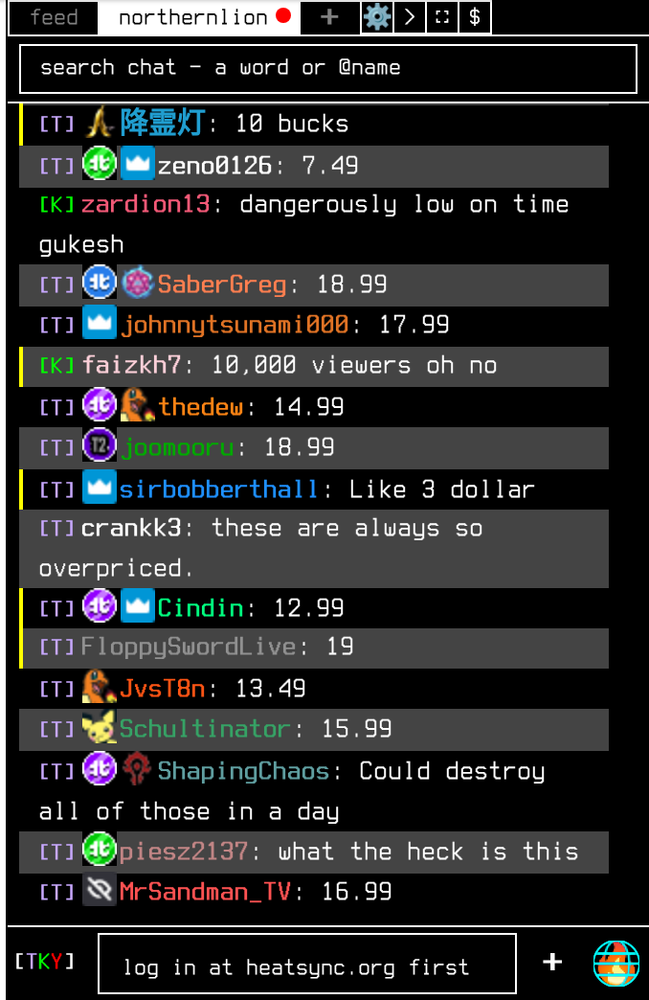

# heatsync



twitch, kick and youtube live chat in one panel — read all your channels at once and reply into any of them without alt-tabbing. a streamer live on all three is one tab. plus your own emotes in any channel: 5,000 free slots, no streamer setup. other heatsync users see them; everyone else sees the plain name.

## install

- **chrome, edge, brave and other chromium browsers** — [chrome web store](https://chromewebstore.google.com/detail/heatsync/afadollcanjpemaonbgnkhjddaebjeja). one click, updates itself.
- **firefox 128+** — [firefox add-ons](https://addons.mozilla.org/firefox/addon/heatsync-chat/). one click, updates itself. or open the signed [heatsync-firefox.xpi](https://github.com/mellen9999/heatsync-extension/releases/latest/download/heatsync-firefox.xpi) with firefox — same code, updates itself from this repo's releases.

then open any twitch, kick or youtube stream: the panel takes over the chat column and a short tour shows you around. reading needs no account. sending uses your twitch, kick or youtube login; the emote inventory needs a free [heatsync.org](https://heatsync.org) account.

## features

- **one panel, every chat** — a tab per channel, or one tab per streamer with their twitch, kick and youtube chats merged (show or hide each). mentions and whispers tabs, a live-follows list, and an import of your twitch and kick follows. resize it, dock it to any edge, or pop it out.
- **your emotes, any channel** — a 5,000-slot inventory that works in twitch's and kick's own chat and in the panel, any channel, no streamer opt-in. tab-complete any 7tv emote and send it — it's added for you. upload your own, or copy a channel's whole emote list in one click. gif and emoji tabs in the picker.
- **7tv, bttv and ffz built in** — their emotes, paints and badges (channel, global, personal) render on their own, next to heatsync's own name paints and badges. no other extension needed.
- **keyboard-first** — emotes turn into pictures as you type, up/down brings back what you sent, replies on twitch and kick, and a search box narrows the live chat to a word, `@name` or `/regex/`. opt-in vim keys in every chat box — twitch, kick, youtube and the panel (normal/insert, motions, operators, `.` repeat).
- **moderation** — hover buttons you pick (delete, timeouts, purge, ban, unban), mod slash commands, twitch's automod queue with allow/deny, a mod tools panel (shield mode, unban requests, automod level, blocked terms) and a mod log. on twitch, kick and youtube, as far as each platform allows.
- **people** — profile cards with followage, sub status, badges, pronouns and your private notes, and their chat history a click away. mute or block someone and it follows their linked accounts. one-click clips of live twitch streams.
- **filters + alerts** — rules that highlight or hide messages by word, pattern, user, badge or kind; hide bots, commands and repeats. mention sounds, an opt-in desktop notification, and what you've read follows you across tabs and devices when signed in.
- **stream events** — going live, offline, game switches, raids, hype trains, subs, redeems, predictions, polls, youtube super chats and memberships, each one toggleable. channel points claim themselves on twitch.
- **34 languages**, right-to-left included.
- **light** — vanilla js, zero runtime dependencies. chat buffers and on-screen rows are capped, so memory holds steady through a long session.

## privacy

no ad trackers and no third-party analytics — nothing goes to google analytics, sentry or any ad network.

- signed in, your inventory and settings sync through heatsync's own servers. settings also ride your browser's own sync if you have it on.
- a line you send through heatsync tells heatsync.org its message id and the emotes in it (on twitch, the text too), so other heatsync users see your emotes. it's public chat either way.
- the one usage count is a check-in to heatsync.org: a random id that changes every midnight, added to daily totals, never stored. opt-in on firefox.
- opening a channel lets heatsync.org archive its public chat — never whispers. anyone can erase their own messages at [heatsync.org/erase](https://heatsync.org/erase).
- it talks to 7tv, bttv and ffz, because that is where their emotes live. pronouns come through heatsync.org, so pronoundb never sees you.

the [privacy policy](https://heatsync.org/legal/privacy) lists exactly what goes where.

## build from source

needs [bun](https://bun.sh), plus node for the syntax check.

```bash
bun install
bun run build.js chrome    # → dist/chrome/
bun run build.js firefox   # → dist/firefox/
bun run build.js --package # both, minified, + store zips + source zip
```

load it: chrome `chrome://extensions` → developer mode → load unpacked → `dist/chrome`. firefox `about:debugging` → this firefox → load temporary add-on → `dist/firefox/manifest.json`.

every github release carries `heatsync-source-X.Y.Z.zip`: unpack it, run the same steps, and you get the shipped files byte for byte.

every build runs the unit tests first (`--no-test` skips them, never with `--package`), then `node --check` on the output. it builds into `dist/<browser>.staging` and swaps into `dist/<browser>` only when everything passes, so a failed build never leaves a half-built folder. `multichat-core.js` and `background.js` are build output, not tracked — edit `src/multichat/` and `src/background/`.

## contributing

`bun test`, `bun run lint` and `bun run typecheck` are the gates. `git config core.hooksPath .githooks` runs them, plus the build and bundle budget, before every push. [CONTRIBUTING.md](CONTRIBUTING.md) has the setup, [docs/ARCHITECTURE.md](docs/ARCHITECTURE.md) has what runs where, and [CHANGELOG.md](CHANGELOG.md) has what changed in each version.

some files are byte-for-byte copies of heatsync.org's own code — the user card, the stream event wording, gif search, emote refs, the emote law, the brand tokens, the name-paint compiler. `scripts/sync-site-copies.sh` and `scripts/sync-paint-compiler.sh` list them, and a parity test fails in ci if one drifts. the site repo is private, so don't edit them here: say what you need in an issue or your pr, and the change lands on the site first.

## releasing

maintainer runbook: [docs/RELEASING.md](docs/RELEASING.md).

---

[MIT](LICENSE) · [security](SECURITY.md) · [trademark](TRADEMARK.md) — not affiliated with twitch, kick, youtube, 7tv, bttv or ffz.
